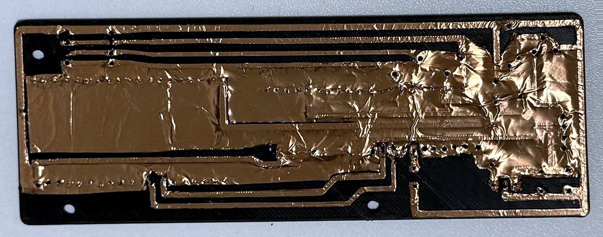
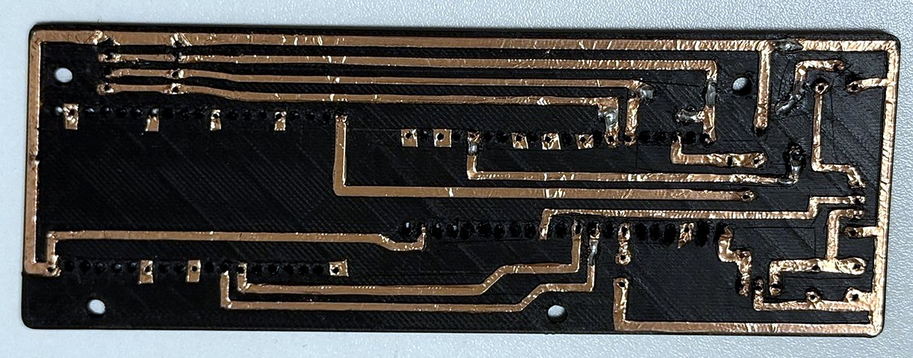
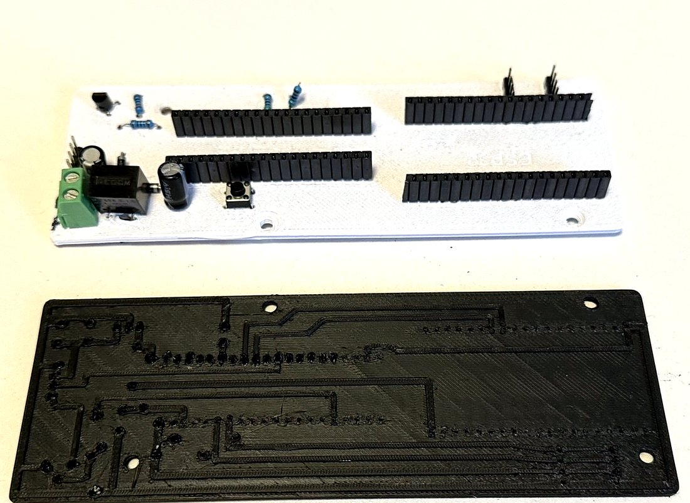
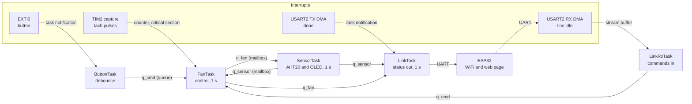
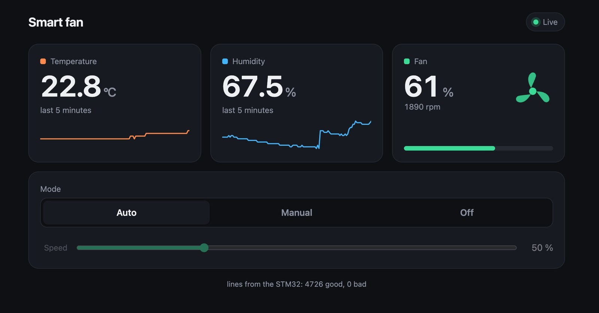
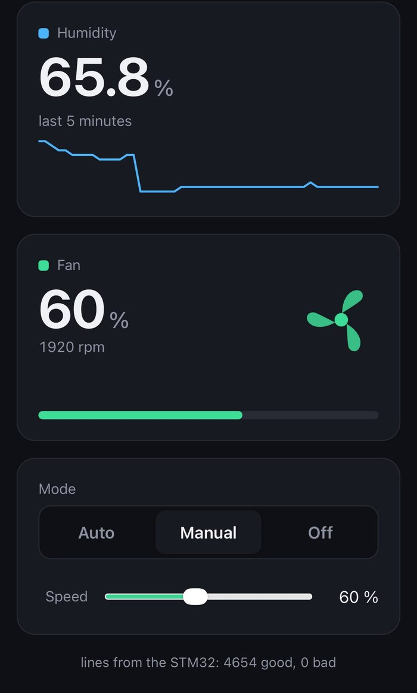

# Smart desk fan

[](https://github.com/Hani256/smart-fan/actions/workflows/ci.yml)

A desk fan that picks its own speed from the room temperature, built on an
STM32F411 running FreeRTOS, with an ESP32 next to it that puts the fan on a
web page. I built it to actually use in summer, and to get properly
comfortable with an RTOS by writing one real project on it rather than by
reading about one.

The circuit board is not a PCB from a fab. I designed it myself, printed it
on a 3D printer and laid copper tape on raised ridges for the tracks. More
on that below, because it turned out to be the most interesting part.

<!-- Photo of the finished fan goes here: docs/images/device.jpg -->

## What it does

- Reads temperature and humidity from an AHT20 once a second and shows them,
  with the fan speed and mode, on a small OLED
- Sets the speed of a 4 pin 12 V PC fan from a comfort curve, with
  hysteresis, a limit on how fast the speed may change, and a short full
  power kick when the fan starts from standstill
- Measures how fast the fan really turns from its tachometer wire, so the
  firmware knows the actual speed and not just the one it asked for
- Falls back to a fixed safe speed when the temperature reading is stale, and
  brings the sensor back by itself after it has been unplugged
- Three modes, Auto, Manual and Off, switched with a button on the board or
  from the web page
- An ESP32 on the same board joins the home WiFi and serves a dashboard with
  live values, the last five minutes as small graphs, and the mode controls.
  Its firmware is updated over WiFi
- 25 unit tests for the control logic and the serial protocol, run by GitHub
  Actions on every push together with a build of both firmwares

## The board: 3D printed, with copper tape tracks

Instead of ordering a PCB and waiting for it, or etching one with chemicals
at home, I printed the board in PLA. It is a 1.6 mm plate with every track
standing 0.6 mm above it as a ridge with slightly bevelled edges, and every
component hole already in place. Copper tape goes over the whole top, gets pressed down onto the ridges, and
is then cut away along their edges with a craft knife, so only the ridges
keep their copper. What is left is a single sided board that takes ordinary
through hole parts and solders like a normal one. A mistake costs a few grams
of PLA and another print, not a new order and a week of waiting.





It only works if the layout really is single sided, so the routing has no
jumper wires at all. Where a track has to cross another one, a component
does the crossing: the two diodes that feed the Black Pill and the ESP32 from
the 5 V regulator sit with their leads stretched over the tracks underneath
them, and act as bridges.



On the first board (the white one) the Black Pill footprint was flipped, so
its pins did not land where the tracks expected them. The tape method itself
had worked fine. For the second board I took every pin position straight
from photos of the real modules and checked every connection against them
before printing. At the same time I made the holes a little wider, because I
had opened the first ones with a hot needle, and the plate thinner, so the
header pins come all the way through. The second board worked.

<!-- Photo of the finished, populated board goes here: docs/images/board-final.jpg -->

## Firmware architecture

Six tasks, each with one job, and no shared global variables between them
except a single interrupt counter. Everything else moves through FreeRTOS
objects, each picked for the kind of data it carries.



| Task | Priority | Runs | Does |
|---|---|---|---|
| FanTask | 24, Normal | every 1 s, fixed period | applies commands, runs the control logic, sets the PWM, counts RPM |
| SensorTask | 16, BelowNormal | every 1 s | reads the AHT20, recovers the I2C bus, draws the OLED |
| ButtonTask | 16, BelowNormal | on a button interrupt | debounces, sends "next mode" |
| LinkTask | 12, Low4 | every 1 s | sends the status line to the ESP32 with DMA |
| LinkRxTask | 12, Low4 | when bytes arrive | assembles lines, checks them, sends commands |
| defaultTask | 8, Low | every 0.5 s | blinks the LED, so I can see it is alive |

Why each mechanism:

- **Mailboxes** (`q_sensor`, `q_fan`) are one item queues written with
  `xQueueOverwrite` and read with `xQueuePeek`. Readers want the newest value,
  never a backlog, and they always get a whole struct written in one go.
  With separate `volatile` globals the fan task could see a new temperature
  next to an old timestamp.
- **A real queue** (`q_cmd`, four deep) for commands, because two presses in
  a row are two commands and neither may be lost.
- **A stream buffer** between the UART interrupt and `LinkRxTask`. DMA fills
  a circular buffer on its own, the receive-to-idle interrupt hands the new
  bytes over, and the task does the parsing outside the interrupt.
- **Task notifications** where an interrupt only needs to wake one task:
  the button, and the end of a DMA transmission.
- **Fixed period loops** with `vTaskDelayUntil`, so the control loop runs
  every 1000 ms however long one round took.

The interrupts that call FreeRTOS run at priority 5 to 7, below
`configMAX_SYSCALL_INTERRUPT_PRIORITY`, which is what makes the `FromISR`
calls legal there.

## Control

A desk fan does not cool a room, it blows air at the person sitting in front
of it. So there is no loop to close, and the first version, a PID on room
temperature, was the wrong shape: the error never reaches zero, and the
integral just climbs into its limit. What it uses now is a curve:

- below 21 C the fan is off, at 25 C and above it runs at 100 %
- in between, a straight line from 30 %, the slowest speed at which this fan
  starts reliably, up to 100 %
- it switches on at 21 C but only off again at 20 C, so a temperature that
  sits on the threshold cannot make it chatter
- the speed changes by at most 10 % a second, because a sudden change in
  airflow is what a person notices
- starting from standstill it gets 400 ms at full power first
- with no temperature reading younger than 5 s it runs at a fixed 50 % and
  the OLED shows dashes instead of an old number

All of this lives in [`App/fan_control.c`](App/fan_control.c), which has no
dependency on HAL or FreeRTOS. `FanTask` only feeds it and acts on its
answer. That split is what makes it testable on a laptop.

## The link to the ESP32

A text protocol over UART at 115200 baud, one line a second from the STM32
and a line from the ESP32 whenever someone changes the mode:

```
$S,234,452,40,1500,A*38    status: 23.4 C, 45.2 %, fan 40 %, 1500 rpm, Auto
$S,,,50,1500,A*3F          the same, temperature stale
$M,M,60*06                 command: Manual at 60 %
$M,A*20  $M,O*2E           command: Auto, Off
```

The two hex digits at the end are an NMEA style checksum, the XOR of every
character between `$` and `*`. A line that fails it is thrown away, so a
damaged byte can never turn into a wrong value. The format and parsing live
in [`App/link_proto.c`](App/link_proto.c).

## The ESP32 and the dashboard



<p align="center"></p>

The ESP32 (Arduino framework, built with PlatformIO) reads the status lines,
checks them, and serves a small web page from its own flash, so it works
without internet. The page asks for `/status.json` once a second and draws
the values, a graph of the last five minutes, and a spinning fan whose speed
follows the real RPM. The mode buttons and the slider send `POST /mode`,
which the ESP32 turns into a command line for the STM32.

Some details that took some finding:

- The router sometimes refuses the ESP32 for a while right after it resets,
  because it still remembers the old connection. The ESP32 keeps retrying
  every 10 s instead of giving up, and the serial link keeps working
  meanwhile
- The board layout leaves no room for a USB cable on the ESP32, so after the
  first upload all updates go over WiFi (OTA), protected by a password
- The WiFi and OTA passwords are in files that git ignores. Example files
  with placeholders are in the repository

## Testing

### Unit tests

The control logic and the protocol are tested on the computer with
[Unity](https://github.com/ThrowTheSwitch/Unity), no board needed. Each test
is a small story about how the fan should behave, for example
`test_temperature_on_the_threshold_does_not_make_it_chatter` or
`test_any_single_damaged_character_is_caught`, which changes every character
of a valid command to every other printable character, about a thousand
damaged lines, and checks that none of them is accepted.

```
cmake -S tests -B build/tests
cmake --build build/tests
ctest --test-dir build/tests --output-on-failure
```

Writing them found two real bugs, both now fixed:

- **Manual speed below 30 % made the fan surge.** The protocol allows any
  speed from 0 to 100. Asked for 20 %, the slew limit and the start speed
  fought each other and the fan went 30, 20, 30, 20 every second
- **A space was accepted as a checksum digit.** `sscanf` with `%x` skips
  white space, so `$M,M,60* 6` passed. Harmless in that case, since the
  command itself was intact, but a protocol that accepts a damaged line is
  not doing its job. The checksum now has to be exactly two hex digits

### CI

GitHub Actions runs three jobs on every push: the unit tests, the STM32
firmware build with the ARM toolchain, and the ESP32 build with PlatformIO.

### On the board

What the unit tests cannot cover I check by hand after every change that
touches the hardware side:

1. Warm the sensor with a finger: above 21 C the fan kicks, then runs at
   30 % and climbs, never by more than 10 % a second
2. Unplug the sensor's SDA wire: within 5 s the OLED and the page show
   dashes and the fan goes to 50 %. Plug it back in: the readings return
3. Button: A, M, O and round again, holding it counts once
4. Page: switch modes and move the slider, the OLED follows within 2 s
5. At 100 % the RPM reads about 3000, the rated top speed of this fan

## Hardware

| | |
|---|---|
| MCU | STM32F411CEU6 "Black Pill", 96 MHz from a 25 MHz crystal |
| Fan | ARCTIC P12 Pro, 4 pin, 12 V |
| Fan PWM | TIM1 CH1 on PA8, 25 kHz (above hearing), through a PN2222A |
| Tachometer | TIM2 CH1 on PA5, input capture, internal pull-up |
| Sensor and display | AHT20 and SSD1306 OLED on I2C1, PB6 and PB7, 400 kHz |
| Mode button | PA0, falling edge interrupt, internal pull-up |
| ESP32 link | USART2, PA2 (TX) to GPIO16, PA3 (RX) from GPIO4, both with DMA |
| Power | 12 V jack for the fan, 5 V switching regulator for both modules |

The transistor on the fan's PWM wire inverts the signal, so the timer
channel is set to active low and the duty in the code still means what it
says. The tach wire is open collector. On the new board it relies on the
STM32's internal pull-up, and it is filtered twice: the timer's input filter
ignores anything shorter than about 11 us, and the interrupt ignores any edge
that comes less than 5 ms after the last one, which would be 6000 rpm, twice
what this fan can do.

## Hardware files

- [`hardware/board.stl`](hardware/board.stl): the board, ready to print
- [`hardware/enclosure/`](hardware/enclosure/): the enclosure parts
- [`hardware/BOM.md`](hardware/BOM.md): every part, with order numbers
- [`hardware/BOARD_GUIDE.md`](hardware/BOARD_GUIDE.md): making the board,
  part polarity, pin map and the wiring off the board

## Building

**STM32.** A STM32CubeMX project with a CMake build. Needs the ARM GNU
toolchain, CMake and Ninja.

```
cmake --preset Debug
cmake --build build/Debug
st-flash write build/Debug/smart_fan.bin 0x8000000
```

The peripheral setup is in `smart_fan.ioc`. Everything written by hand is
inside the `USER CODE` markers or in `App/`, so regenerating from CubeMX does
not wipe it.

**ESP32.** A PlatformIO project in `esp32/`. Copy the two example files and
fill them in first:

```
cp esp32/src/secrets.example.h esp32/src/secrets.h
cp esp32/secrets.example.ini esp32/secrets.ini
```

Then upload with the `esp32dev` environment over USB the first time, and with
the `ota` environment over WiFi after that.

## Known limits

- The ESP32 checks the checksum of incoming lines the same lenient way the
  STM32 did before the tests caught it. Same fix, not done yet
- A mode change takes up to a second to reach the fan, because `FanTask`
  looks at its command queue once per period. Fine for a fan, and easy to
  make immediate by blocking on the queue instead
- Only `SensorTask` uses the I2C bus, so it has no mutex. The day a second
  task needs the bus, it gets one

## Licence

MIT, see LICENSE.
